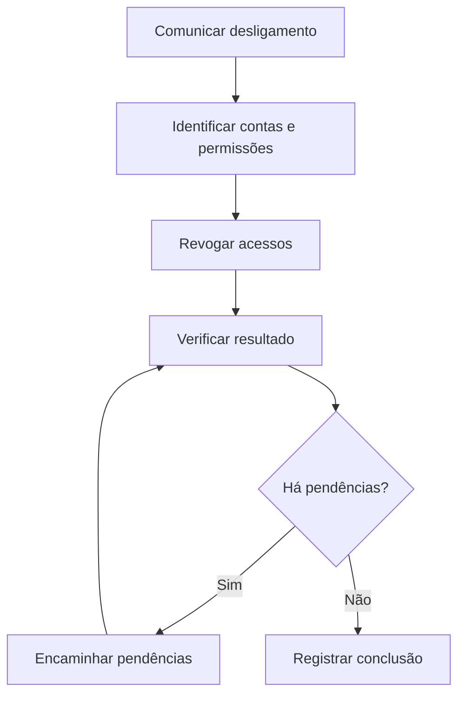

# Políticas de segurança e revogação de acessos

## Visão geral

O que acontece quando uma pessoa sai de uma empresa, mas sua conta continua ativa? Ela pode manter acesso a sistemas e informações mesmo depois do fim do vínculo profissional.

Neste estudo de caso da **Cisco Networking Academy (NetAcad)**, analisei um cenário fictício da empresa de saúde **ACME Healthcare**. A atividade aborda problemas de segurança encontrados em uma auditoria e a importância de criar regras e procedimentos para proteger as informações.

O foco desta documentação é a **revogação de acessos no desligamento de funcionários**: como organizar as etapas e evitar que contas continuem disponíveis sem necessidade.

---

## Objetivos

* Compreender a diferença entre política, padrão, diretriz e procedimento.
* Analisar problemas de segurança apresentados em uma auditoria.
* Entender os riscos de manter contas ativas após o desligamento de funcionários.
* Organizar uma proposta de revogação de acessos com etapas e responsabilidades.
* Reconhecer a importância de comunicar e revisar as regras de segurança.

---

## Cenário do estudo

A ACME Healthcare é uma empresa fictícia do setor de saúde. No laboratório, uma auditoria identifica problemas de segurança relacionados a contas, permissões, senhas, acesso remoto e rede sem fio, entre outros pontos.

Um dos problemas é a **existência de contas de pessoas que já deixaram a empresa**. Isso representa um risco porque os acessos podem continuar disponíveis mesmo quando não existe mais uma necessidade profissional.

---

## Problemas de segurança analisados

| Problema apresentado                          | Por que representa um risco?                             | Medida de segurança relacionada |
| --------------------------------------------- | -------------------------------------------------------- | ------------------------------- |
| Contas de ex-funcionários permanecem ativas   | O acesso pode continuar depois do desligamento.          | Revogação de acessos            |
| Contas com privilégios sem autorização formal | Uma pessoa pode ter permissões além do necessário.       | Controle de permissões          |
| Acesso remoto inseguro                        | A comunicação pode expor informações e credenciais.      | Proteção do acesso remoto       |
| Senhas descobertas durante a auditoria        | Outras pessoas podem utilizar essas credenciais.         | Proteção de senhas              |
| Rede sem fio protegida por WEP                | Esse método de segurança possui fragilidades conhecidas. | Proteção da rede Wi-Fi          |

A documentação aprofunda o primeiro problema: **como retirar os acessos quando um funcionário deixa a organização**.

---

## Política, padrão, diretriz e procedimento

| Termo            | Explicação simples                          | Exemplo                                                    |
| ---------------- | ------------------------------------------- | ---------------------------------------------------------- |
| **Política**     | Define uma regra que deve ser seguida.      | Os acessos devem ser retirados após o desligamento.        |
| **Padrão**       | Estabelece requisitos para cumprir a regra. | Registrar as ações realizadas.                             |
| **Diretriz**     | Orienta boas práticas.                      | Utilizar uma lista de verificação.                         |
| **Procedimento** | Explica as etapas de uma atividade.         | Receber o aviso, localizar as contas e retirar os acessos. |

---

## Proposta de revogação de acessos

### Objetivo

Evitar que pessoas que já deixaram a empresa continuem com acesso aos sistemas e às informações da organização.

### Etapas do processo proposto

| Etapa                           | O que deve acontecer?                                                   |
| ------------------------------- | ----------------------------------------------------------------------- |
| **1. Comunicar o desligamento** | Informar que o vínculo profissional será encerrado.                     |
| **2. Identificar os acessos**   | Levantar as contas, os sistemas e as permissões utilizados pela pessoa. |
| **3. Retirar as permissões**    | Bloquear ou remover os acessos que não devem continuar ativos.          |
| **4. Verificar**                | Conferir se os acessos identificados foram tratados.                    |
| **5. Registrar a conclusão**    | Documentar as ações realizadas e eventuais pendências.                  |

Essas etapas apresentam uma **proposta de procedimento** para o estudo de caso, não uma configuração executada em sistemas.

---

## Fluxograma da proposta

---

## Importância da comunicação

Uma política de segurança precisa ser compreendida pelas pessoas envolvidas. No caso da revogação de acessos, é importante que a comunicação do desligamento chegue a quem cuida das contas e permissões, para que as ações necessárias não sejam esquecidas.

A documentação das etapas também facilita o acompanhamento e a verificação do processo.

---

## Principais aprendizados

* **Contas ativas após um desligamento representam um risco.** O acesso deve acompanhar a necessidade profissional.
* **Políticas e procedimentos cumprem funções diferentes.** A política estabelece a regra; o procedimento mostra como aplicá-la.
* **O controle de acesso vai além de bloquear uma conta.** É import
